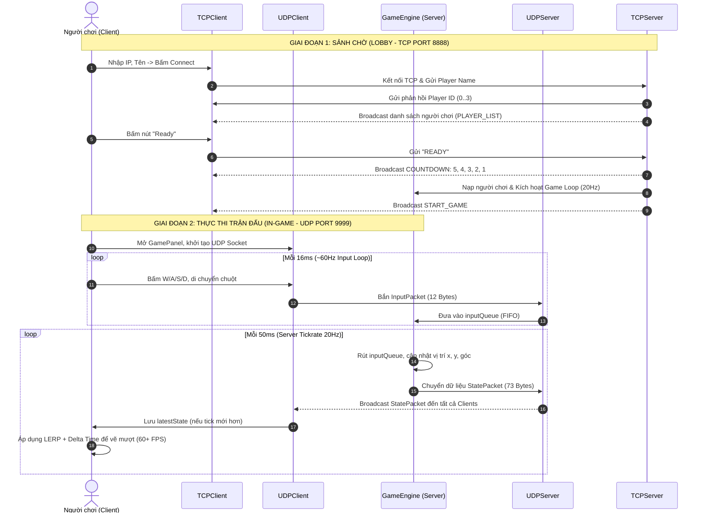

# TÀI LIỆU TOÀN DIỆN VỀ KIẾN TRÚC, CÁC TỆP TIN VÀ LOGIC DỰ ÁN
## Đề tài: Trực Thăng Đối Kháng (Altitude Attack Multiplayer) - Nhóm 02

Tài liệu này cung cấp bản mô tả chi tiết, toàn diện về cấu trúc tổ chức mã nguồn, vai trò cụ thể của từng tệp tin trong toàn bộ hệ thống (gồm cả Client, Server và các tài liệu hướng dẫn/đặc tả .md), cùng phân tích chuyên sâu về dữ liệu, giao thức mạng và logic vận hành.

---

## PHẦN 1: Ý NGHĨA VÀ NHIỆM VỤ CHÍNH CỦA TỪNG THƯ MỤC LỚN

Dự án được tách biệt thành hai dự án Maven độc lập chạy song song, tuân thủ mô hình **Client - Authoritative Server**:

```
Altitude-Attack-Multiplayer_Nhom02/
├── (Các file tài liệu .md & cấu hình gốc)
├── HelicopterServer/           # Ứng dụng Server điều hành logic và mạng
│   ├── pom.xml
│   └── src/main/java/
│       ├── main/              # Điểm khởi chạy hệ thống Server
│       ├── network/           # Quản lý giao tiếp TCP & UDP
│       └── game/              # Lõi mô phỏng thế giới game (Physics, Game Loop)
│
└── HelicopterClient/           # Ứng dụng Client hiển thị và điều khiển
    ├── pom.xml
    └── src/main/java/
        ├── main/              # Điểm khởi chạy ứng dụng Client
        ├── gui/               # Màn hình giao diện sảnh chờ (Swing Form/Lobby)
        ├── game/              # Khung đồ họa in-game và bắt sự kiện phím/chuột
        └── network/           # Bộ điều hợp mạng kết nối đến Server
```

### 1. Thư mục gốc (`Altitude-Attack-Multiplayer_Nhom02/`)
* **Ý nghĩa:** Là root repository chứa toàn bộ mã nguồn của nhóm, lưu trữ cấu hình Git và tập hợp các văn bản tài liệu hóa: đề tài đồ án, kế hoạch 6 tuần, kiến thức nền tảng lý thuyết và hướng dẫn kiến trúc thư mục.
* **Nhiệm vụ:** Đảm bảo tính toàn vẹn của mã nguồn dự án, đồng bộ hóa giữa các thành viên, cung cấp đặc tả thống nhất để các lập trình viên (Dev Server, Dev Client, Dev Network) làm việc ăn khớp.

### 2. Thư mục dự án `HelicopterServer/`
* **Ý nghĩa:** Dự án Server độc lập đóng vai trò là **máy chủ có thẩm quyền tối cao (Authoritative Server)**. Server không có giao diện đồ họa nặng (headless console application), ưu tiên hiệu năng xử lý tính toán số học và I/O mạng.
* **Nhiệm vụ chính:**
  1. Mở cổng TCP (port 8888) tiếp nhận kết nối phòng chờ, quản lý định danh người chơi (`playerId`), điểm danh sẵn sàng và đếm ngược khởi động trận đấu.
  2. Mở cổng UDP (port 9999) nhận gói tin thao tác điều khiển (`InputPacket`) từ mọi Client và phát sóng trạng thái thế giới (`StatePacket`) với tần số cố định **20Hz (50ms/tick)**.
  3. Cập nhật vị trí, vận tốc, quán tính, góc nhìn của các máy bay trực thăng và xử lý va chạm, luật chơi, tính điểm.

* **Các package con trong `HelicopterServer`:**
  * `main`: Chứa class khởi tạo, liên kết các module mạng với vòng lặp game.
  * `network`: Chứa socket mạng TCP/UDP phía Server, tiến trình phục vụ từng người chơi (`ClientHandler`), và cấu trúc nhị phân gói tin.
  * `game`: Chứa đối tượng thực thể người chơi (`Player`) và trái tim điều phối vòng lặp mô phỏng vật lý (`GameEngine`).

### 3. Thư mục dự án `HelicopterClient/`
* **Ý nghĩa:** Dự án Client dành cho người chơi, đóng vai trò như một bộ điều khiển ("tay cầm") và màn hình hiển thị ("màn hình TV"). Client không tự ý đưa ra kết quả phân định game mà gửi ý định người chơi lên Server và nhận trạng thái về để biểu diễn.
* **Nhiệm vụ chính:**
  1. Cung cấp giao diện đồ họa GUI đăng nhập, nhập IP máy chủ, đặt tên và hiển thị danh sách phòng chờ qua TCP.
  2. Sau khi trận đấu bắt đầu, chuyển đổi cửa sổ thành màn hình game Canvas 2D (`JPanel`), bắt sự kiện phím (W, A, S, D) và tọa độ con trỏ chuột.
  3. Gửi đều đặn lệnh điều khiển qua UDP lên Server (~60Hz).
  4. Lắng nghe trạng thái mới nhất từ Server qua UDP và thực hiện **nội suy chuyển động (Interpolation / Lerp)** kết hợp Delta Time để hình ảnh hiển thị siêu mượt trên màn hình người chơi (mở khóa FPS, không bị giật lag theo nhịp 20Hz của Server).

* **Các package con trong `HelicopterClient`:**
  * `main`: Điểm khởi chạy luồng đồ họa Swing (`EventDispatchThread`).
  * `gui`: Quản lý cửa sổ phòng chờ (`LobbyFrame`), xử lý sự kiện kết nối và phản hồi lệnh TCP từ Server.
  * `game`: Quản lý canvas vẽ đồ họa máy bay, lắng nghe bàn phím, tính toán nội suy đồ họa (`GamePanel`).
  * `network`: Chứa module quản lý Socket TCP (`TCPClient`), UDP (`UDPClient`) và cấu trúc giải mã gói tin.
  * `assets` *(thư mục tài nguyên - dự kiến ở các tuần tiếp theo)*: Nơi chứa hình ảnh trực thăng, đạn, bản đồ hang động và âm thanh.

---

## PHẦN 2: MÔ TẢ CỤ THỂ TỪNG FILE TRONG HỆ THỐNG

### 2.1. Các tệp tin tài liệu và cấu hình tại thư mục gốc

| Tệp tin | Định dạng | Mô tả chi tiết & Vai trò trong dự án |
| :--- | :--- | :--- |
| [`.gitignore`](file:///c:/Users/olive/Documents/NetBeansProjects/Altitude-Attack-Multiplayer_Nhom02/.gitignore) | Git Config | Cấu hình cho Git bỏ qua việc đồng bộ các file biên dịch rác, thư mục `target/` của Maven, thư mục ẩn `build/`, `.nb-gradle/`, `nbproject/private/` của NetBeans, giúp repository luôn sạch sẽ và tránh xung đột mã cá nhân. |
| [`detai.md`](file:///c:/Users/olive/Documents/NetBeansProjects/Altitude-Attack-Multiplayer_Nhom02/detai.md) | Markdown | **Phiếu đăng ký đề tài chính thức** nộp cho Khoa CNTT. Chứa thông tin nhóm (Nhóm 02 - Lớp 23DTHE4), danh sách 3 thành viên, bản đặc tả chi tiết về bài toán game bắn trực thăng 2D trong hang động, chức năng phân tách rõ ràng giữa Client và Server, cơ chế chống hack/chống spam đạn, timeout 5 giây, Client-side prediction và Interpolation. |
| [`KeHoachPhatTrien.md`](file:///c:/Users/olive/Documents/NetBeansProjects/Altitude-Attack-Multiplayer_Nhom02/KeHoachPhatTrien.md) | Markdown | **Lộ trình triển khai dự án trong 6 tuần**: phân công 3 vai trò (Dev Server, Dev Network, Dev Client) đi qua 6 mốc: Thiết kế kiến trúc/packet (Tuần 1) -> TCP Lobby & Game loop (Tuần 2) -> UDP di chuyển cơ bản (Tuần 3) -> Vật lý/Bắn đạn/Va chạm (Tuần 4) -> Kiểm thử LAN/Stress test/Wireshark (Tuần 5) -> Hoàn thiện báo cáo, demo OBS và nộp bài (Tuần 6). |
| [`KienThucNenTang.md`](file:///c:/Users/olive/Documents/NetBeansProjects/Altitude-Attack-Multiplayer_Nhom02/KienThucNenTang.md) | Markdown | **Sổ tay lý thuyết cốt lõi về Game Networking**: Hướng dẫn 8 khái niệm sống còn đối với người mới làm game mạng: Game Loop, phân biệt FPS (Client) vs Tickrate (Server), nguyên tắc Server độc quyền (Authoritative Server), khái niệm Game State Snapshot, tính ưu việt của UDP trong game đối kháng, kỹ thuật nội suy (Interpolation), hệ tọa độ 2D của Java (trục Y hướng xuống dưới), và lý do dùng `ByteBuffer` thay cho String text. |
| [`CauTrucThuMuc.md`](file:///c:/Users/olive/Documents/NetBeansProjects/Altitude-Attack-Multiplayer_Nhom02/CauTrucThuMuc.md) | Markdown | Tài liệu giải thích và hướng dẫn tạo cây thư mục chuẩn trong IDE NetBeans, nhấn mạnh việc dùng chung 2 file cầu nối mạng (`InputPacket.java` và `StatePacket.java`) giữa cả 2 dự án Client và Server. |
| [`CLAUDE.md`](file:///c:/Users/olive/Documents/NetBeansProjects/Altitude-Attack-Multiplayer_Nhom02/CLAUDE.md) | Markdown | Bản quy chuẩn nguyên tắc lập trình (Best Practices): tư duy kỹ trước khi code, ưu tiên giải pháp tinh gọn, chỉ sửa đổi tối thiểu đúng trọng tâm (surgical changes), kiểm thử chặt chẽ theo mục tiêu đặt ra. |

---

### 2.2. Các tệp tin thuộc dự án `HelicopterServer`

```
HelicopterServer/
├── pom.xml
└── src/main/java/
    ├── main/
    │   └── ServerMain.java
    ├── game/
    │   ├── GameEngine.java
    │   └── Player.java
    └── network/
        ├── TCPServer.java
        ├── ClientHandler.java
        ├── UDPServer.java
        ├── InputPacket.java
        └── StatePacket.java
```

#### 1. [`pom.xml`](file:///c:/Users/olive/Documents/NetBeansProjects/Altitude-Attack-Multiplayer_Nhom02/HelicopterServer/pom.xml)
* **Loại:** File cấu hình quản lý dự án Apache Maven.
* **Chi tiết:** Khai báo thông tin `groupId`, `artifactId` (`HelicopterServer`), đóng gói `jar`, cấu hình trình biên dịch Java Compiler (`release 24`) và mã hóa UTF-8. Giúp quản lý quy trình build độc lập mà không bị ràng buộc tuyệt đối vào IDE NetBeans.

#### 2. [`ServerMain.java`](file:///c:/Users/olive/Documents/NetBeansProjects/Altitude-Attack-Multiplayer_Nhom02/HelicopterServer/src/main/java/main/ServerMain.java) (Package: `main`)
* **Vai trò:** Lớp chứa hàm khởi động `public static void main(String[] args)` của toàn bộ Server.
* **Logic thực thi:**
  1. Khởi tạo và kích hoạt lắng nghe socket của `UDPServer` trên một luồng nền.
  2. Tạo đối tượng bộ máy trò chơi `GameEngine`, truyền thể hiện `UDPServer` vào để mượn đường truyền UDP (lấy hàng đợi input và phát sóng trạng thái).
  3. Khởi tạo `TCPServer` (chuyền `engine` vào) và gọi `tcpServer.start()` tại port 8888 để sẵn sàng đón nhận các Client kết nối.

#### 3. [`TCPServer.java`](file:///c:/Users/olive/Documents/NetBeansProjects/Altitude-Attack-Multiplayer_Nhom02/HelicopterServer/src/main/java/network/TCPServer.java) (Package: `network`)
* **Vai trò:** Quản trị kết nối TCP hướng luồng cho sảnh chờ (Lobby).
* **Nhiệm vụ & Logic:**
  * Lắng nghe tại port `8888` bằng `ServerSocket`.
  * Giới hạn tối đa 4 người chơi (`MAX_PLAYERS = 4`). Nếu phòng đầy, gửi phản hồi `"FULL"` và lập tức đóng kết nối của socket mới.
  * Tự động cấp phát định danh người chơi tăng dần (`nextPlayerId`).
  * Quản lý danh sách an toàn đa luồng `CopyOnWriteArrayList<ClientHandler> clients`.
  * Cung cấp các phương thức thông báo: `broadcastPlayerList()` (cập nhật danh sách người chơi phòng chờ), `broadcastMessage(msg)`.
  * Quản lý trạng thái đếm ngược bắt đầu: Phương thức `checkAllReady()` kiểm tra nếu có $\ge 2$ người chơi và tất cả đều đã nhấn Ready, kích hoạt luồng đếm ngược 5 giây (`COUNTDOWN:5` ... `COUNTDOWN:1`). Khi hết giờ, nạp người chơi vào `GameEngine`, gửi lệnh `START_GAME` đến các Client và kích hoạt luồng game loop của `GameEngine`.
  * Nếu có người chơi ngắt kết nối đột ngột trong lúc đếm ngược, kích hoạt `cancelCountdown()`, gửi `CANCEL_COUNTDOWN` cho các Client còn lại.

#### 4. [`ClientHandler.java`](file:///c:/Users/olive/Documents/NetBeansProjects/Altitude-Attack-Multiplayer_Nhom02/HelicopterServer/src/main/java/network/ClientHandler.java) (Package: `network`)
* **Vai trò:** Luồng riêng biệt (`extends Thread`) đảm nhiệm giao tiếp TCP 1-1 với một Client cụ thể.
* **Nhiệm vụ & Logic:**
  * Đọc tên người chơi vừa gửi lên bằng `DataInputStream.readUTF()`.
  * Phản hồi lại ID được cấp phát cho Client qua `DataOutputStream.writeByte(playerId)`.
  * Yêu cầu `TCPServer` phát sóng danh sách người chơi mới nhất cho toàn phòng.
  * Lắng nghe các thông điệp tiếp theo từ Client (đặc biệt là thông điệp `"READY"` để cập nhật `isReady = true` và kích hoạt `server.checkAllReady()`).
  * Bắt ngoại lệ khi Client mất kết nối (`IOException`), tự động dọn dẹp tài nguyên và gọi `server.removeClient(this)` để thông báo cho những người còn lại.

#### 5. [`UDPServer.java`](file:///c:/Users/olive/Documents/NetBeansProjects/Altitude-Attack-Multiplayer_Nhom02/HelicopterServer/src/main/java/network/UDPServer.java) (Package: `network`)
* **Vai trò:** Bộ máy giao tiếp mạng tốc độ cao không liên kết (Datagram) phục vụ quá trình in-game.
* **Nhiệm vụ & Logic:**
  * Mở socket `DatagramSocket` tại port `9999`.
  * Chạy một background thread liên tục nhận các `DatagramPacket` có buffer 1024 bytes.
  * Khi nhận được gói tin, giải mã thành `InputPacket` thông qua `InputPacket.fromBytes()`.
  * Ghi nhớ/cập nhật địa chỉ mạng UDP (`InetSocketAddress`: IP + Port) của người chơi đó vào bảng băm `ConcurrentHashMap<Byte, InetSocketAddress> clientAddresses` (giúp Server biết đường gửi ngược dữ liệu về cho dù Client dùng port ngẫu nhiên).
  * Đưa gói `InputPacket` vào hàng đợi an toàn đa luồng `ConcurrentLinkedQueue<InputPacket> inputQueue` để chờ `GameEngine` xử lý theo nhịp tick.
  * Phương thức `broadcastState(byte[] stateData)`: Lặp qua danh sách địa chỉ UDP của các người chơi đang kết nối và bắn gói tin `DatagramPacket` chứa trạng thái mới nhất về.

#### 6. [`InputPacket.java`](file:///c:/Users/olive/Documents/NetBeansProjects/Altitude-Attack-Multiplayer_Nhom02/HelicopterServer/src/main/java/network/InputPacket.java) (Package: `network`)
* **Vai trò:** Định nghĩa cấu trúc gói tin điều khiển từ Client gửi lên Server.
* **Thuộc tính:**
  * `sequenceNumber` (int, 4 bytes): Số thứ tự gói tin để loại trừ gói cũ/sai thứ tự.
  * `playerId` (byte, 1 byte): Mã định danh người chơi gửi gói tin.
  * `moveX` (byte, 1 byte): Hướng ngang (-1: Trái, 0: Đứng im, 1: Phải).
  * `moveY` (byte, 1 byte): Hướng dọc (-1: Lên, 0: Đứng im, 1: Xuống).
  * `mouseAngle` (float, 4 bytes): Góc xoay nòng súng theo chuột (đơn vị Radian).
  * `isShooting` (boolean, 1 byte): Trạng thái bấm chuột bắn.
* **Phương thức:**
  * `toBytes()`: Sử dụng `ByteBuffer.allocate(12)` tuần tự hóa thành mảng đúng 12 bytes.
  * `fromBytes(byte[] data)`: Dùng `ByteBuffer.wrap(data)` giải mã ngược lại thành đối tượng.

#### 7. [`StatePacket.java`](file:///c:/Users/olive/Documents/NetBeansProjects/Altitude-Attack-Multiplayer_Nhom02/HelicopterServer/src/main/java/network/StatePacket.java) (Package: `network`)
* **Vai trò:** Định nghĩa cấu trúc ảnh chụp trạng thái toàn bộ phòng chơi (World State Snapshot) do Server gửi broadcast về cho các Client.
* **Thuộc tính:**
  * `tick` (int, 4 bytes): Số thứ tự nhịp tính toán của Server.
  * `playerCount` (byte, 1 byte): Số lượng người chơi hiện đang có trong phòng.
  * Dữ liệu mảng cố định tối đa 4 người chơi:
    * `playerIds` (byte[4], 4 bytes)
    * `playerXs` (float[4], 16 bytes)
    * `playerYs` (float[4], 16 bytes)
    * `playerAngles` (float[4], 16 bytes)
    * `playerHPs` (byte[4], 4 bytes)
* **Kích thước gói tin:** Tổng cộng $4 + 1 + 4 \times (1 + 4 + 4 + 4 + 1) = 73$ bytes.
* **Phương thức:** `toBytes()` và `fromBytes()` sử dụng `ByteBuffer` để đóng/mở gói nhị phân cực nhanh.

#### 8. [`GameEngine.java`](file:///c:/Users/olive/Documents/NetBeansProjects/Altitude-Attack-Multiplayer_Nhom02/HelicopterServer/src/main/java/game/GameEngine.java) (Package: `game`)
* **Vai trò:** Trái tim tính toán thế giới game của Server (`implements Runnable`).
* **Nhiệm vụ & Logic:**
  * Chạy vòng lặp game cố định ở tần số **20Hz (Tickrate 20, mỗi tick nghỉ 50ms)**.
  * Quản lý danh sách thực thể `ConcurrentHashMap<Byte, Player> players`.
  * Trong mỗi chu kỳ tick:
    1. `processInputs()`: Lấy hết toàn bộ `InputPacket` từ `UDPServer.getInputQueue()`. Với mỗi người chơi tương ứng, cập nhật vận tốc mục tiêu `vx = moveX * speed` và `vy = moveY * speed`, cập nhật góc ngắm `angle`.
    2. `updatePhysics()`: Cộng dồn tọa độ `x += vx`, `y += vy` và kiểm tra chặn biên giới hạn màn hình ($[0, 800] \times [0, 600]$).
    3. `checkCollisions()`: Điểm nối dành cho xử lý va chạm đạn - người chơi ở giai đoạn sau.
    4. `broadcastState()`: Đóng gói toàn bộ thông số tọa độ, HP, góc quay của mọi người chơi vào `StatePacket` rồi chuyển giao cho `UDPServer.broadcastState()` bắn về cho tất cả Client.

#### 9. [`Player.java`](file:///c:/Users/olive/Documents/NetBeansProjects/Altitude-Attack-Multiplayer_Nhom02/HelicopterServer/src/main/java/game/Player.java) (Package: `game`)
* **Vai trò:** Lớp thực thể (Data Entity) lưu trữ toàn bộ trạng thái sống còn của một người chơi trên máy chủ.
* **Thuộc tính:** `id` (byte), vị trí `x, y` (float), vận tốc `vx, vy` (float), góc quay `angle` (float), lượng máu `hp` (byte, khởi tạo mặc định 100).

---

### 2.3. Các tệp tin thuộc dự án `HelicopterClient`

```
HelicopterClient/
├── pom.xml
└── src/main/java/
    ├── main/
    │   └── ClientMain.java
    ├── gui/
    │   └── LobbyFrame.java
    ├── game/
    │   └── GamePanel.java
    └── network/
        ├── TCPClient.java
        ├── UDPClient.java
        ├── InputPacket.java
        └── StatePacket.java
```

#### 1. [`pom.xml`](file:///c:/Users/olive/Documents/NetBeansProjects/Altitude-Attack-Multiplayer_Nhom02/HelicopterClient/pom.xml)
* **Loại:** File cấu hình Maven của dự án Client.
* **Chi tiết:** Khai báo cấu hình `HelicopterClient`, phiên bản Java 24, UTF-8, cấu hình class chạy chính cho phép thực thi độc lập.

#### 2. [`ClientMain.java`](file:///c:/Users/olive/Documents/NetBeansProjects/Altitude-Attack-Multiplayer_Nhom02/HelicopterClient/src/main/java/main/ClientMain.java) (Package: `main`)
* **Vai trò:** Điểm kích hoạt chương trình Client.
* **Logic:** Sử dụng `java.awt.EventQueue.invokeLater()` để khởi tạo và hiển thị cửa sổ `LobbyFrame` một cách an toàn trên luồng giao diện người dùng Swing (EDT).

#### 3. [`LobbyFrame.java`](file:///c:/Users/olive/Documents/NetBeansProjects/Altitude-Attack-Multiplayer_Nhom02/HelicopterClient/src/main/java/gui/LobbyFrame.java) (Package: `gui`)
* **Vai trò:** Cửa sổ giao diện đồ họa (GUI Form) quản lý sảnh chờ trước trận đấu (`extends JFrame implements TCPClient.TCPListener`).
* **Các thành phần giao diện:**
  * Ô nhập Server IP (`txtServerIP`), Tên người chơi (`txtPlayerName`), nút "Connect" (`btnConnect`).
  * Danh sách hiển thị những người chơi trong phòng (`playerList` dùng `DefaultListModel`).
  * Nút "Ready" (`btnReady`), nhãn trạng thái kết nối/đếm ngược (`lblStatus`).
* **Logic vận hành:**
  * Nhấn `Connect`: Gọi một luồng nền để kết nối TCP đến Server. Nếu thành công, vô hiệu hóa ô nhập, mở khóa nút Ready, nhận `myPlayerId`.
  * Nhấn `Ready`: Gửi thông điệp `"READY"` qua TCP Client.
  * Phản hồi Callback từ `TCPListener`:
    * `onPlayerListUpdated(data)`: Phân tích chuỗi `"PLAYER_LIST:id,name;..."` và cập nhật lên `JList`.
    * `onCountdown(sec)`: Cập nhật nhãn đếm ngược từ 5 về 1 giây.
    * `onCountdownCancelled()`: Thông báo bị hủy đếm ngược nếu có người thoát.
    * `onGameStart()`: Chuyển pha mượt mà: Xóa toàn bộ component phòng chờ, phóng to kích thước cửa sổ lên 800x600, khởi tạo `UDPClient` kết nối tới IP Server, gắn `GamePanel` vào cửa sổ, yêu cầu `requestFocus()` để bắt đầu điều khiển in-game.

#### 4. [`GamePanel.java`](file:///c:/Users/olive/Documents/NetBeansProjects/Altitude-Attack-Multiplayer_Nhom02/HelicopterClient/src/main/java/game/GamePanel.java) (Package: `game`)
* **Vai trò:** Khung đồ họa vẽ trận đấu thực tế (`extends JPanel`), thu thập sự kiện phím chuột và thực hiện thuật toán nội suy làm mượt.
* **Kiến trúc luồng (Multi-threading):**
  1. **Luồng gửi Input (~60Hz, mỗi 16ms):** Đóng gói trạng thái hiện thời của các phím W, A, S, D thành `InputPacket` và gửi lên Server qua `UDPClient.sendInput()`.
  2. **Luồng vẽ Render (Vẽ liên tục, trễ tối thiểu 2ms):** Liên tục gọi `repaint()` để ép Swing vẽ lại màn hình nhanh nhất có thể theo khả năng phần cứng.
* **Lắng nghe sự kiện:**
  * `KeyAdapter`: Bắt trạng thái đè/thả của các phím W (lên), S (xuống), A (trái), D (phải).
  * `MouseMotionAdapter`: Cập nhật liên tục tọa độ chuột `mouseX, mouseY`.
* **Thuật toán Nội suy Lerp + Delta Time trong `paintComponent(Graphics g)`:**
  * Client không vẽ giật cục theo gói tin 20Hz của Server. Thay vào đó, tạo một lớp con `ClientPlayer(x, y)` đại diện cho tọa độ hiển thị thực tế trên màn hình.
  * Tính toán khoảng thời gian trôi qua giữa hai frame vẽ: $\Delta t = (now - lastTime) / 10^9$ (giây).
  * Áp dụng công thức làm mượt **Linear Interpolation (LERP)** với hệ số trượt `lerpSpeed = 15.0f`:
    $$x_{hiển thị} = x_{hiển thị} + (x_{đích} - x_{hiển thị}) \times lerpSpeed \times \Delta t$$
    $$y_{hiển thị} = y_{hiển thị} + (y_{đích} - y_{hiển thị}) \times lerpSpeed \times \Delta t$$
  * Máy bay của chính mình được tô màu XANH LÁ (`Color.GREEN`), đối thủ tô màu ĐỎ (`Color.RED`) với nhãn tên Player ID tương ứng.

#### 5. [`TCPClient.java`](file:///c:/Users/olive/Documents/NetBeansProjects/Altitude-Attack-Multiplayer_Nhom02/HelicopterClient/src/main/java/network/TCPClient.java) (Package: `network`)
* **Vai trò:** Xử lý kết nối TCP từ Client đến cổng 8888 của Server.
* **Logic:**
  * Khởi tạo `Socket(serverIP, 8888)`. Gửi tên người chơi qua `DataOutputStream.writeUTF()`.
  * Đọc định danh `myPlayerId = in.readByte()`.
  * Khởi chạy luồng Daemon `listenThread` liên tục chờ nhận thông điệp text từ Server và kích hoạt các phương thức của Interface `TCPListener`:
    * Nhận `"PLAYER_LIST:"` $\rightarrow$ `listener.onPlayerListUpdated()`
    * Nhận `"COUNTDOWN:"` $\rightarrow$ `listener.onCountdown()`
    * Nhận `"START_GAME"` $\rightarrow$ `listener.onGameStart()`
    * Nhận `"CANCEL_COUNTDOWN"` $\rightarrow$ `listener.onCountdownCancelled()`
  * Cung cấp hàm `sendReady()` để gửi chuỗi `"READY"` lên Server.

#### 6. [`UDPClient.java`](file:///c:/Users/olive/Documents/NetBeansProjects/Altitude-Attack-Multiplayer_Nhom02/HelicopterClient/src/main/java/network/UDPClient.java) (Package: `network`)
* **Vai trò:** Xử lý kênh truyền UDP tốc độ cao tới cổng 9999 của Server.
* **Logic:**
  * Mở một socket UDP ngẫu nhiên `DatagramSocket`.
  * Biến cờ `public volatile StatePacket latestState`: Lưu snapshot thế giới game mới nhất nhận được từ Server.
  * Chạy một luồng nền liên tục nhận `DatagramPacket`, giải mã qua `StatePacket.fromBytes()`.
  * **Cơ chế chống gói tin lỗi thời/đến trễ:** Chỉ cập nhật `latestState` khi `state.tick > latestState.tick`. Nếu một gói tin cũ bị trễ mạng tới sau gói tin mới, nó sẽ tự động bị loại bỏ.
  * Cung cấp phương thức `sendInput(InputPacket)` để bắn mảng 12 bytes lên Server cực nhanh.

#### 7. [`InputPacket.java`](file:///c:/Users/olive/Documents/NetBeansProjects/Altitude-Attack-Multiplayer_Nhom02/HelicopterClient/src/main/java/network/InputPacket.java) & [`StatePacket.java`](file:///c:/Users/olive/Documents/NetBeansProjects/Altitude-Attack-Multiplayer_Nhom02/HelicopterClient/src/main/java/network/StatePacket.java) (Package: `network`)
* **Vai trò:** Cặp lớp nhị phân dùng chung giống hệt 100% với phía Server. Chúng đóng vai trò là "ngôn ngữ chung" (Protocol Data Unit) để Client và Server hiểu nhau ở tầng nhị phân mà không có sự sai lệch về thứ tự đọc/ghi byte.

---

## PHẦN 3: DỮ LIỆU VÀ LOGIC CHÍNH CỦA DỰ ÁN

### 1. Kiến trúc tổng thể & Mô hình trao đổi dữ liệu (Network Flow)

Dự án áp dụng mô hình phân tách 2 giao thức mạng kinh điển trong lập trình Game Multiplayer:



---

### 2. Chi tiết Byte-Layout các gói tin nhị phân

Thay vì dùng chuỗi ký tự (String/JSON) gây tiêu tốn CPU (phải parse chuỗi) và tốn băng thông đường truyền, dự án sử dụng trực tiếp cấu trúc nhị phân qua `java.nio.ByteBuffer`:

#### A. Cấu trúc `InputPacket` (Client $\rightarrow$ Server: 12 Bytes)
```
+--------------------+--------------+------------+------------+--------------------+---------------------+
| SequenceNum (int)  | PlayerID     | MoveX      | MoveY      | MouseAngle (float) | IsShooting (byte)   |
| 4 Bytes (Offset 0) | 1 B (Off 4)  | 1 B (Off 5)| 1 B (Off 6)| 4 Bytes (Offset 7) | 1 Byte (Offset 11)  |
+--------------------+--------------+------------+------------+--------------------+---------------------+
Tổng kích thước = 12 Bytes
```
* **Ý nghĩa:**
  * `MoveX`, `MoveY`: Nhận giá trị rời rạc $\{-1, 0, 1\}$.
  * `MouseAngle`: Góc lượng giác hướng bắn tính theo chuột.
  * `SequenceNum`: Thứ tự gói tin để Server có thể theo dõi độ trễ hoặc bỏ qua gói bị đến lộn xộn.

#### B. Cấu trúc `StatePacket` (Server $\rightarrow$ Client: 73 Bytes)
```
Header:
+-------------------+---------------------+
| Tick (int)        | PlayerCount (byte)  |
| 4 Bytes (Off 0)   | 1 Byte (Off 4)      |
+-------------------+---------------------+

Thân gói tin (Lặp lại 4 lần cho 4 Slots Người chơi):
Mỗi Slot người chơi (17 Bytes):
+-------------+------------------+------------------+----------------------+-------------+
| ID (byte)   | X (float)        | Y (float)        | Angle (float)        | HP (byte)   |
| 1 Byte      | 4 Bytes          | 4 Bytes          | 4 Bytes              | 1 Byte      |
+-------------+------------------+------------------+----------------------+-------------+

Tổng kích thước = 4 (Tick) + 1 (Count) + 4 x 17 (Slots) = 73 Bytes
```
* **Ý nghĩa:** Gói tin cố định kích thước 73 bytes này cực kỳ nhỏ gọn, cho phép broadcast qua UDP 20 lần/giây mà không gây nghẽn băng thông mạng LAN hay Internet.

---

### 3. Logic điều phối chính trong hệ thống

#### A. Nguyên lý Authoritative Server (Máy chủ toàn quyền)
* Client hoàn toàn **không** gửi tọa độ `x, y` của mình lên Server. Client chỉ gửi **ý định di chuyển** (`moveX = 1`, `moveY = -1`).
* Server là nơi duy nhất giữ tọa độ thực của tất cả người chơi trong `players.values()`.
* Server tính toán:
  $$x_{mới} = x_{cũ} + v_x = x_{cũ} + (moveX \times 5.0)$$
  $$y_{mới} = y_{cũ} + v_y = y_{cũ} + (moveY \times 5.0)$$
* Điều này ngăn chặn triệt để hành vi hack dịch chuyển (teleport hack) hoặc can thiệp tốc độ di chuyển từ phía Client.

#### B. Xung đột tần số: 20Hz Tickrate vs 60+ FPS Rendering
* **Vấn đề:** Server chỉ cập nhật và gửi tọa độ 20 lần/giây (cách nhau $50ms$). Nếu màn hình Client vẽ theo tọa độ này, mắt người sẽ thấy máy bay bị giật khựng mỗi $50ms$.
* **Giải pháp đã cài đặt trong [`GamePanel.java`](file:///c:/Users/olive/Documents/NetBeansProjects/Altitude-Attack-Multiplayer_Nhom02/HelicopterClient/src/main/java/game/GamePanel.java):**
  * Tách biệt **tọa độ mạng nhận về** (`targetX, targetY`) với **tọa độ hiển thị màn hình** (`rp.x, rp.y`).
  * Áp dụng thuật toán nội suy Lerp kết hợp Delta Time:
    ```java
    float deltaTime = (now - lastTime) / 1_000_000_000.0f;
    rp.x += (targetX - rp.x) * lerpSpeed * deltaTime;
    rp.y += (targetY - rp.y) * lerpSpeed * deltaTime;
    ```
  * Nhờ thuật toán này, máy bay luôn trượt êm ái về vị trí mới nhất, mang lại cảm giác mượt mà 60–144 FPS trên mọi loại màn hình.

#### C. Chống gói tin UDP đến trễ / sai thứ tự
* Do giao thức UDP không đảm bảo thứ tự gói tin, gói gửi sau có thể đến trước gói gửi trước.
* Cơ chế xử lý trong [`UDPClient.java`](file:///c:/Users/olive/Documents/NetBeansProjects/Altitude-Attack-Multiplayer_Nhom02/HelicopterClient/src/main/java/network/UDPClient.java):
  ```java
  if (latestState == null || state.tick > latestState.tick) {
      latestState = state;
  }
  ```
  Nếu một gói tin có `tick` nhỏ hơn hoặc bằng `latestState.tick` vừa nhận, Client lập tức vứt bỏ, tránh hiện tượng nhân vật bị "giật lùi thời gian".

---

## PHẦN 4: BẢNG ÁNH XẠ VÀ QUAN HỆ GIỮA CÁC FILE

| File Client | File Server tương ứng | Vai trò kết nối / Cơ chế tương tác |
| :--- | :--- | :--- |
| [`ClientMain.java`](file:///c:/Users/olive/Documents/NetBeansProjects/Altitude-Attack-Multiplayer_Nhom02/HelicopterClient/src/main/java/main/ClientMain.java) | [`ServerMain.java`](file:///c:/Users/olive/Documents/NetBeansProjects/Altitude-Attack-Multiplayer_Nhom02/HelicopterServer/src/main/java/main/ServerMain.java) | Điểm vào của 2 tiến trình độc lập (Client chạy trên nhiều máy, Server chạy trên 1 máy chủ). |
| [`LobbyFrame.java`](file:///c:/Users/olive/Documents/NetBeansProjects/Altitude-Attack-Multiplayer_Nhom02/HelicopterClient/src/main/java/gui/LobbyFrame.java) | [`TCPServer.java`](file:///c:/Users/olive/Documents/NetBeansProjects/Altitude-Attack-Multiplayer_Nhom02/HelicopterServer/src/main/java/network/TCPServer.java) & [`ClientHandler.java`](file:///c:/Users/olive/Documents/NetBeansProjects/Altitude-Attack-Multiplayer_Nhom02/HelicopterServer/src/main/java/network/ClientHandler.java) | Kết nối qua TCP Port 8888: Trao đổi danh sách sảnh chờ, tín hiệu Ready, đếm ngược và chuyển pha. |
| [`GamePanel.java`](file:///c:/Users/olive/Documents/NetBeansProjects/Altitude-Attack-Multiplayer_Nhom02/HelicopterClient/src/main/java/game/GamePanel.java) | [`GameEngine.java`](file:///c:/Users/olive/Documents/NetBeansProjects/Altitude-Attack-Multiplayer_Nhom02/HelicopterServer/src/main/java/game/GameEngine.java) & [`Player.java`](file:///c:/Users/olive/Documents/NetBeansProjects/Altitude-Attack-Multiplayer_Nhom02/HelicopterServer/src/main/java/game/Player.java) | Khung Canvas Client vẽ thế giới theo dữ liệu mô phỏng vật lý của `GameEngine` và thực thể `Player`. |
| [`UDPClient.java`](file:///c:/Users/olive/Documents/NetBeansProjects/Altitude-Attack-Multiplayer_Nhom02/HelicopterClient/src/main/java/network/UDPClient.java) | [`UDPServer.java`](file:///c:/Users/olive/Documents/NetBeansProjects/Altitude-Attack-Multiplayer_Nhom02/HelicopterServer/src/main/java/network/UDPServer.java) | Giao tiếp qua UDP Port 9999: Truyền nhận 2 luồng dữ liệu thời gian thực (`InputPacket` lên, `StatePacket` về). |
| [`InputPacket.java`](file:///c:/Users/olive/Documents/NetBeansProjects/Altitude-Attack-Multiplayer_Nhom02/HelicopterClient/src/main/java/network/InputPacket.java) | [`InputPacket.java`](file:///c:/Users/olive/Documents/NetBeansProjects/Altitude-Attack-Multiplayer_Nhom02/HelicopterServer/src/main/java/network/InputPacket.java) | **Cầu nối nhị phân 12 Bytes**: Client đóng gói $\rightarrow$ Server giải mã vào hàng đợi `inputQueue`. |
| [`StatePacket.java`](file:///c:/Users/olive/Documents/NetBeansProjects/Altitude-Attack-Multiplayer_Nhom02/HelicopterClient/src/main/java/network/StatePacket.java) | [`StatePacket.java`](file:///c:/Users/olive/Documents/NetBeansProjects/Altitude-Attack-Multiplayer_Nhom02/HelicopterServer/src/main/java/network/StatePacket.java) | **Cầu nối nhị phân 73 Bytes**: Server đóng gói $\rightarrow$ Client giải mã vào biến `latestState`. |
| - | [`Player.java`](file:///c:/Users/olive/Documents/NetBeansProjects/Altitude-Attack-Multiplayer_Nhom02/HelicopterServer/src/main/java/game/Player.java) | ClientPlayer (nội bộ trong `GamePanel`) tương ứng lưu tọa độ hiển thị cho thực thể `Player` trên Server. |

---

## TỔNG KẾT

Dự án **Trực Thăng Đối Kháng** của Nhóm 02 hiện đã hoàn thành vững chắc nền móng kiến trúc:
1. Phân chia rõ ràng trách nhiệm giữa TCP (điều khiển tin cậy, sảnh chờ) và UDP (đồng bộ thời gian thực siêu tốc).
2. Định dạng nhị phân gói tin tối ưu tuyệt đối bằng `ByteBuffer`.
3. Giải quyết bài toán giật lag bằng thuật toán **Lerp Interpolation** kết hợp Delta Time.
4. Tuân thủ nghiêm ngặt mô hình **Authoritative Server** để đảm bảo tính công bằng và dễ dàng mở rộng các tính năng bắn đạn, va chạm và đồ họa sprite trong các tuần tiếp theo.
